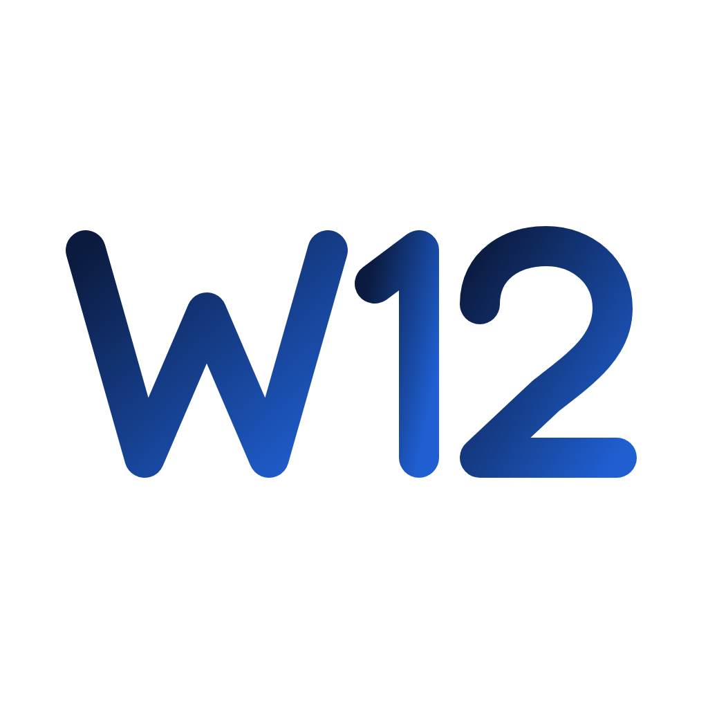

<p align="center">
  
</p>

<h1 align="center">Anh 7</h1>

<p align="center">
  Ứng dụng macOS chạy giao diện <b>Win12 Online</b> (tiếng Việt) như một màn hình desktop,
  kết nối với máy Mac thật và máy ảo macOS.
</p>

> Dự án cá nhân, phục vụ học tập. **Không liên quan** và **không được bảo trợ** bởi Microsoft.
> Giao diện desktop dựa trên dự án mã nguồn mở [Win12 Online](https://github.com/win12-online/win12).

---

## Tính năng

| Nhóm | Mô tả |
|---|---|
| Desktop Win12 | Toàn bộ giao diện Win12 Online, Việt hoá 100% |
| Ứng dụng Mac | Mở ứng dụng thật của máy Mac ngay từ Win12 |
| Tệp Mac | Duyệt, xem, sửa, đổi tên, đưa vào thùng rác file thật trong thư mục nhà |
| Cài đặt > Máy Mac | Âm lượng, chế độ tối, độ sáng, Wi‑Fi, Bluetooth, khoá máy, ngủ, hình nền, thông tin máy |
| Máy ảo macOS | Cài và chạy macOS trong một cửa sổ Win12 (Virtualization.framework), có thư mục chia sẻ |
| Trợ lý máy ảo | Liệt kê và mở ứng dụng bên trong máy ảo từ Win12 |
| Bản di động | Xuất toàn bộ app + dữ liệu ra USB để dùng trên máy khác |

## Yêu cầu

- Mac chip Apple (M1 trở lên). **Không hỗ trợ Mac Intel.**
- macOS 14 Sonoma trở lên (khuyến nghị).
- Máy ảo: cần thêm khoảng 20–70 GB trống và RAM từ 8 GB.

## Cài đặt (dùng bản có sẵn)

1. Vào mục **[Releases](../../releases)**, tải file `Anh7-<phiên bản>-macOS-AppleSilicon.zip`.
2. Giải nén, kéo **Anh 7.app** vào thư mục **Applications**.
3. Lần đầu mở, macOS sẽ chặn vì app chưa được Apple công chứng (notarize):
   - Mở **System Settings → Privacy & Security**, kéo xuống, bấm **Open Anyway**; hoặc
   - Chạy lệnh: `xattr -dr com.apple.quarantine "/Applications/Anh 7.app"`

## Tự build từ mã nguồn

Cần Xcode (để có `swiftc` và `actool`).

```bash
# 1. Mã nguồn app (thư mục tuỳ ý)
git clone https://github.com/<tài-khoản>/Anh7.git
cd Anh7

# 2. Mã nguồn Win12 Online (bắt buộc đặt ở ~/win12)
git clone https://github.com/win12-online/win12.git ~/win12

# 3. Việt hoá + gắn các phần mở rộng Mac vào Win12
./vi-patch.sh
./mac-patch.sh

# 4. Build và mở app (/Applications/Anh 7.app)
./build.sh
```

## Cấu trúc

| Đường dẫn | Nội dung |
|---|---|
| `main.swift` | Cửa sổ app, WebView, cầu nối JS ⇄ Swift |
| `HostBridge.swift` | Điều khiển máy Mac: file, âm lượng, Wi‑Fi, Bluetooth… |
| `VMManager.swift` | Cài đặt và chạy máy ảo macOS |
| `mac-*.js` | Phần mở rộng gắn vào Win12 (Ứng dụng, Máy ảo, Tệp Mac, Cài đặt, dữ liệu thật) |
| `lang_vi.properties`, `vi-runtime.js` | Bản dịch tiếng Việt |
| `vi-patch.sh`, `mac-patch.sh` | Script áp các thay đổi trên vào mã nguồn Win12 |
| `agent/` | Trợ lý chạy bên trong máy ảo |
| `build.sh`, `release.sh` | Build app, đóng gói bản phát hành |

## Giấy phép và ghi công

- **Win12 Online** © tjy-gitnub (Tan Jingyuan), Starry Source và cộng đồng đóng góp,
  phát hành theo **Eclipse Public License 2.0**. Hình ảnh/âm thanh của Win12 theo **CC BY‑SA**.
  Xem [NOTICE.md](NOTICE.md).
- Mã nguồn riêng của Anh 7 và các thay đổi trên Win12 trong repo này phát hành theo **EPL‑2.0** — xem [LICENSE](LICENSE).
- "Windows" là thương hiệu của Microsoft Corporation. Dự án này không dùng thương hiệu đó làm tên sản phẩm.

---

<sub>Anh 7 is a personal macOS app that hosts the open-source Win12 Online desktop (Vietnamese translation) in a native shell with Mac integrations and a macOS virtual machine. Not affiliated with Microsoft.</sub>
